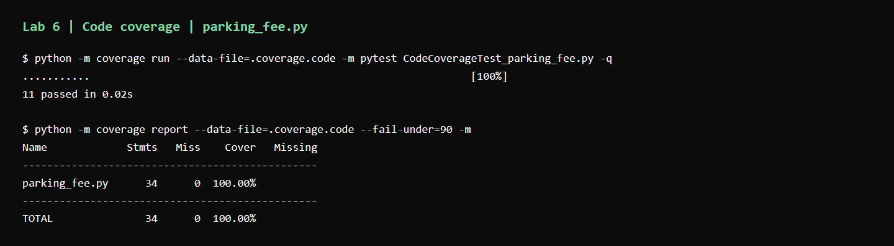
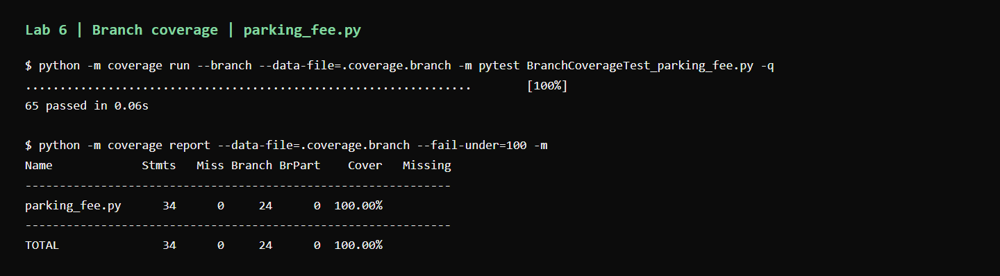

# Lab 6: Code and Branch Coverage — Parking Fee

**Student:** Devansh Gupta · **SRN:** PES1UG24CS145

**Assigned repository:** <https://github.com/SETAPESU26/L6_L7_19_parking_fee>

**Source commit:** `af37455c32c127506e00acc63ccd5e3309c7ce0b`

The assigned `parking_fee.py` and `test_parking_fee.py` are copied unchanged
from the repository's `Lab 6/` directory. The application calculates parking
fees, chooses a parking floor, and prices monthly passes.

## Setup

Run these commands from `Lab-6/` with Python 3.11 or later:

```powershell
python -m venv .venv
.\.venv\Scripts\Activate.ps1
python -m pip install -r requirements.txt
```

If PowerShell blocks activation, use `.\.venv\Scripts\python.exe` in place of
`python` in the commands below. Coverage measures only `parking_fee.py` via
`.coveragerc`; tests are outside the coverage denominator.

## Initial coverage

```powershell
python -m coverage run --data-file=.coverage.baseline-line -m pytest test_parking_fee.py -q
python -m coverage report --data-file=.coverage.baseline-line -m
python -m coverage run --branch --data-file=.coverage.baseline-branch -m pytest test_parking_fee.py -q
python -m coverage report --data-file=.coverage.baseline-branch -m
```

Both starter tests pass. They execute 15 of 34 statements (**44.12%**) and
8 of 24 branch outcomes (**33.33%**). No monthly-pass path is exercised;
paid parking, errors, EV discounts, ticket penalties, and the special slot
assignments are also untested.

The branch-mode `Cover` column is a combined statement-and-branch percentage:
`(15 + 8) / (34 + 24) = 39.66%`. It is different from branch coverage alone.
The raw output is in [reports/baseline.txt](reports/baseline.txt), and the
counts are in [reports/baseline.json](reports/baseline.json).

The handout requests screenshots only after reaching at least 90% coverage,
so the initial results are retained as text and JSON.

## Code coverage submission

`CodeCoverageTest_parking_fee.py` contains 11 cases. They exercise the free
stay, rounded paid hours, EV reduction, lost-ticket penalty, both validation
errors, every slot return, both pass prices, the resident discount, and the
unsupported-pass error.

```powershell
python -m coverage run --data-file=.coverage.code -m pytest CodeCoverageTest_parking_fee.py -q
python -m coverage report --data-file=.coverage.code --fail-under=90 -m
```

**Result:** 11 tests pass and all 34 statements execute (**100% line coverage**).
The screenshot captures the unedited terminal transcript saved in
[reports/code_coverage.txt](reports/code_coverage.txt).



### Why full line coverage is insufficient

Running the same 11 cases with `coverage run --branch` reaches only 20 of
24 branch outcomes (**83.33% branch coverage**). The combined `Cover` column
shows 93.10%, even though branch coverage alone is below 90%.

| Missing arc | Decision still untested |
| --- | --- |
| `13 -> 15` | A paid stay is an exact number of hours, so no rounding occurs. |
| `16 -> 18` | No EV discount applies. |
| `18 -> 20` | The ticket is retained, so no penalty applies. |
| `40 -> 42` | A non-resident pays the full monthly-pass price. |

The diagnostic output is in
[reports/code_suite_branch_diagnostic.txt](reports/code_suite_branch_diagnostic.txt)
and its [JSON report](reports/code_suite_branch_diagnostic.json). It has no
screenshot because this suite's branch coverage is below the required 90%.

## Branch coverage submission

`BranchCoverageTest_parking_fee.py` contains 65 independent cases and reaches
every statement and branch without relying on the starter or code-coverage
suite. It checks:

- Durations 0, 1, 29, 30, 31, 59, 60, 61, 119, 120, and 121 minutes,
  plus long stays and each vehicle's hourly rate.
- Both outcomes of the hour-rounding decision and both sides of the
  30-minute free-stay boundary.
- Non-EVs, eligible EVs, and EV trucks, which receive no discount.
- Retained and lost tickets, including the penalty on free stays and its
  addition after the EV discount.
- Unknown vehicles, negative durations, and validation order when both
  inputs are invalid.
- Zero, negative, and positive slot counts; full-parking priority over
  disabled access; and ground-floor priority over truck basement parking.
- Both pass types, resident and non-resident prices, and unsupported pass
  vehicles with either residency value.

```powershell
python -m coverage run --branch --data-file=.coverage.branch -m pytest BranchCoverageTest_parking_fee.py -q
python -m coverage report --data-file=.coverage.branch --fail-under=100 -m
python -m coverage json --data-file=.coverage.branch -o reports/branch_coverage.json
```

**Result:** 65 tests pass, with **34/34 statements (100%)** and
**24/24 branch outcomes (100%)** covered. There are no missing statements,
missing branches, partial branches, or excluded lines. See the
[terminal transcript](reports/branch_coverage.txt) and
[JSON report](reports/branch_coverage.json).



The PNGs are browser screenshots of their saved, unedited terminal
transcripts. Screenshots are supplied only for the successful code-coverage
and branch-coverage submissions.

## Comparison and interpretation

| Test suite | Passing cases | Statements | Branch outcomes | Combined branch-mode `Cover` |
| --- | ---: | ---: | ---: | ---: |
| Starter | 2 | 15/34 (44.12%) | 8/24 (33.33%) | 39.66% |
| Code coverage | 11 | 34/34 (100%) | 20/24 (83.33%) | 93.10% |
| Branch coverage | 65 | 34/34 (100%) | 24/24 (100%) | 100% |

Line coverage counts executed statements. Branch coverage counts the
outcomes of decisions: reaching an `if` line does not establish that both
its true and false routes were tested. Here, the line suite executes every
statement while missing four routes; the branch suite closes all four.

All three application functions are exercised. Path coverage concerns
complete sequences of decisions and is not measured here. Full branch
coverage does not prove that every possible input or path is correct; the
boundary and policy-interaction assertions add checks beyond the metric.
The expected fees and pass prices are explicit values, so the tests also
check results rather than merely executing paths.

## Run the complete submission

`pytest.ini` includes both handout filename patterns in test discovery.
From `Lab-6/`, run:

```powershell
python -m coverage run --branch --data-file=.coverage.all -m pytest -q
python -m coverage report --data-file=.coverage.all --fail-under=100 -m
```

This runs the two unchanged starter cases, 11 code-coverage cases, and 65
branch-coverage cases: **78 tests total**. The final output is saved in
[reports/all_tests.txt](reports/all_tests.txt).

The commit history groups the starter and baseline, the code-coverage
submission with its evidence, and the branch-coverage submission with its
evidence and final analysis.
